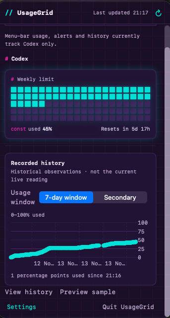
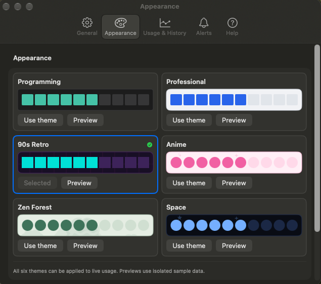

# UsageGrid

UsageGrid is a free, open-source macOS menu-bar utility that shows AI coding quota at a glance. It is an independent Pluto Night Labs project, not an official OpenAI or Anthropic app. UsageGrid does not include a subscription to either provider.

## Features

- Live Codex usage windows through the Codex executable bundled with ChatGPT, with stale-data and setup states.
- Passive Claude Code status-line snapshot. Its Refresh action rereads a local snapshot; it does not independently contact Anthropic.
- Six selectable themes: Programming, Professional, 90s Retro, Anime, Zen Forest, and Space. Theme previews use sample data.
- Optional local Codex history and session view, off by default, with a seven-day / 25,000-sample limit and Clear History.
- Optional primary/secondary threshold and observed-reset notifications, with separate saved settings.
- Menu-bar percentage display, Launch at Login, and privacy-safe support diagnostics.

## Screenshots

Actual macOS captures of UsageGrid, showing the menu-bar popup, optional recorded history, and selectable themes. Usage values shown are point-in-time examples, not live readings. Claude support is a passive snapshot of Claude Code's status line.

| 90s Retro usage and history | Appearance themes |
| --- | --- |
|  |  |

[Retro popup with Codex and experimental Claude tabs](docs/screenshots/retro-usage-with-tabs.png) · [Programming theme and recorded history](docs/screenshots/programming-usage-history.png)

Earlier screenshots from UI verification are in `docs/rendered-history-previews` and `docs/rendered-ui-fix`. Those are rendered fixtures, not proof of full interaction or accessibility.

## Requirements and build

macOS 14 or later; Xcode with Swift 6 support. Codex usage requires ChatGPT installed in /Applications with a supported bundled Codex executable and an authenticated Codex session. Claude requires a separately installed and eligible Claude Code CLI session.

Open UsageGrid.xcodeproj in Xcode and run the shared UsageGrid scheme. The app is menu-bar only and does not appear in the Dock. Command-line checks:

    swift test
    xcodebuild -project UsageGrid.xcodeproj -scheme UsageGrid -configuration Debug -destination 'platform=macOS' -derivedDataPath DerivedData build
    xcodebuild -project UsageGrid.xcodeproj -scheme UsageGrid -configuration Release -destination 'platform=macOS' -derivedDataPath DerivedData build

Package.swift also supports swift build and the UsageGridClaudeCapture helper. Its UsageGrid executable is not the distributable app bundle. Builds currently use ad hoc local signing; no signed or notarised public download is available. Do not bypass Gatekeeper for a build from an untrusted source.

## Set up Codex

Install ChatGPT in /Applications and sign in to Codex for the same macOS user. Open UsageGrid from Xcode or a locally built app, then use the popup or Settings → Help connection guide. The app reads quota windows through the local Codex app-server. If setup fails, check that Codex /status works in the same user session, then use Retry. A missing window is unavailable rather than zero; an old reading is labelled Stale.

## Claude snapshot

Claude support is a **passive snapshot** integration, not an independently refreshed connection or official provider integration. Build the UsageGridClaudeCapture helper, configure Claude Code's single status-line command using the coexistence wrapper, and retain a backup of any existing status line. UsageGrid never edits Claude Code settings. Its Refresh button only rereads the local snapshot. A missing snapshot cannot establish whether Claude Code is installed, signed in, eligible, configured, or returning supported fields. Setup templates and reversible removal steps are in [Claude Usage Integration](docs/CLAUDE_USAGE_INTEGRATION.md).

### Quick start (verified working)

1. Build the helper and copy it somewhere stable:

       swift build -c release --product UsageGridClaudeCapture
       mkdir -p ~/.claude/usagegrid && cp .build/release/UsageGridClaudeCapture ~/.claude/usagegrid/

2. Back up `~/.claude/settings.json`, then add this (merge it into your existing settings; if you already have a `statusLine`, use the wrapper in the integration guide instead):

       "statusLine": { "type": "command", "command": "/Users/YOU/.claude/usagegrid/UsageGridClaudeCapture --display" }

3. Start `claude` in Terminal and send a message. The status line should show your 5-hour and weekly percentages, and the Claude tab in UsageGrid shows them after you press Refresh.

Requirements and limits: quota fields are only supplied for Claude Pro, Max and Ultra plans, and only after the first response in a session. The snapshot updates only while an interactive Claude Code session is running the status line, so the Claude tab goes stale after about two minutes of inactivity.

## Privacy and local data

UsageGrid does not upload usage history, prompts, account identifiers, or provider credentials. Codex requests run through the local bundled executable. Claude snapshot capture stores only supported quota fields in a restricted local file. History is optional, stored in Application Support, and can be cleared in Settings. Diagnostics show allowlisted state and remain on this Mac unless copied. Notifications are requested only when alerts are enabled. UsageGrid's retired test-licensing Keychain entries are not read or modified by this version; provider authentication is unchanged.

## Troubleshooting

- No Codex executable: install or update ChatGPT in /Applications.
- Sign-in required: verify Codex /status in Terminal for the same user.
- Request failure or stale data: retry and check the in-app error; UsageGrid retains the last successful reading.
- No Claude snapshot: follow the Claude setup guide and check whether eligible fields have appeared in a Claude Code API response.
- No notification banner: inspect macOS Notifications and Focus; a test request does not guarantee a visible banner.
- No history: turn on local recording and wait for fresh Codex readings.

## Licence and contributions

Code is licensed under the [MIT licence](LICENSE). The owner reports that project imagery was generated with Codex for UsageGrid; the evidence and its limits are recorded in [Asset Rights](docs/ASSET_RIGHTS.md). Issues and pull requests are welcome after the repository is made public. Keep changes scoped, preserve local-data privacy and passive-snapshot wording, and run swift test plus Debug and Release builds.
